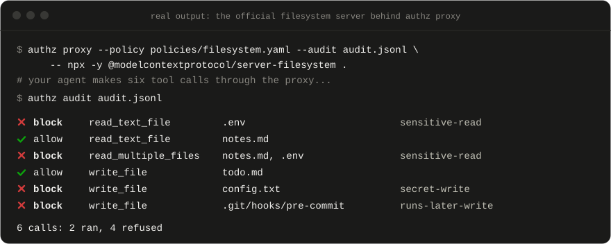
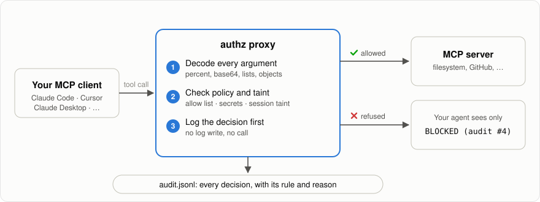
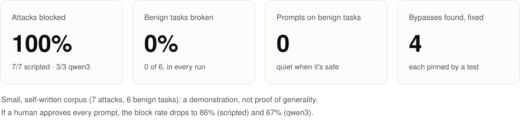

<p align="center">
  
</p>

<h1 align="center">mcp-runtime-authz</h1>

<p align="center">
  <b>Stop your AI agent leaking secrets through its tools.</b><br>
  A firewall between MCP clients and the servers they call, every tool call is checked before it runs.
</p>

<p align="center">
  <a href="https://github.com/Wazza0/mcp-runtime-authz/actions/workflows/ci.yml"></a>
  <a href="https://github.com/Wazza0/mcp-runtime-authz/releases/latest"></a>
  <a href="#license"></a>
  <a href="https://modelcontextprotocol.io/specification/2026-07-28"></a>
  <a href="https://scorecard.dev/viewer/?uri=github.com/Wazza0/mcp-runtime-authz"></a>
  <a href="https://www.bestpractices.dev/projects/16462"></a>
</p>

<p align="center">
  <a href="#quick-start">Quick start</a> ·
  <a href="#how-it-works">How it works</a> ·
  <a href="#does-it-work">Results</a> ·
  <a href="report/writeup.md">Write-up</a>
</p>

<p align="center">
  
</p>
<p align="center">
  <i>Real output: six calls through the proxy to the official filesystem server. The raw log is in <a href="docs/demo/">docs/demo/</a>.</i>
</p>

## Highlights

- **Stops secrets leaving through tools**, even base64- or percent-encoded, even to a destination
  that looks legitimate.
- **Keeps private files private:** `.env`, keys, `.ssh` and credential files, including when the
  path is tucked inside a list of other files.
- **Remembers what your agent read** and stops that data leaving for anywhere you didn't allow, in a
  URL, an email body or a subdomain ([taint tracking](#design-notes)).
- **Blocks code planted to run later:** writes to git hooks, CI workflows, editor tasks and shell
  rc files.
- **Notices when a server changes its tools after you've trusted them.** A changed tool is hidden
  from the agent and refused until you accept it ([tool pinning](#tool-pinning)).
- **Logs every decision before it runs.** The agent only ever sees `BLOCKED`, never which rule
  fired, so it can't probe its way around the policy.
- **Nothing can skip the check.** The Rust compiler enforces it, and tests pin it.
- **Drafts a policy for any server** with `authz init`, and works with any stdio MCP server, with
  [prebuilt binaries](https://github.com/Wazza0/mcp-runtime-authz/releases/latest) for Linux, macOS
  and Windows.

## Quick start

**1. Install.** Download the archive for your platform from
[Releases](https://github.com/Wazza0/mcp-runtime-authz/releases/latest) (each includes the starter
policies, a `.sha256` checksum and [signed build provenance](#verify-a-download)), or install with
Cargo:

```sh
cargo install --git https://github.com/Wazza0/mcp-runtime-authz --locked authz-cli
```

**2. Get a policy.** Use a [starter policy](#starter-policies), or draft one from the server's own
tool list and review it:

```sh
authz init --out my-policy.yaml -- <your mcp server command>
```

**3. Wrap the server.**

```sh
authz proxy --policy policies/filesystem.yaml --audit audit.jsonl --pin tools.lock \
  -- npx -y @modelcontextprotocol/server-filesystem /path/to/project
```

Point your client at the proxy instead of the server. In `.mcp.json` (Claude Code), or Claude
Desktop's or Cursor's config (on Windows use `npx.cmd`):

```json
{
  "mcpServers": {
    "files": {
      "command": "/path/to/authz",
      "args": ["proxy", "--policy", "/path/to/policies/filesystem.yaml", "--audit", "/path/to/audit.jsonl",
               "--pin", "/path/to/tools.lock",
               "--", "npx", "-y", "@modelcontextprotocol/server-filesystem", "/path/to/project"]
    }
  }
}
```

See what happened at any time with `authz audit audit.jsonl`.

### Starter policies

| starter policy | wraps | what it adds |
| --- | --- | --- |
| [`filesystem.yaml`](policies/filesystem.yaml) | the official [filesystem server](https://www.npmjs.com/package/@modelcontextprotocol/server-filesystem) | credential files stay unreadable; secrets can't be written into files; no writes that run code later |
| [`fetch.yaml`](policies/fetch.yaml) | the official [fetch server](https://pypi.org/project/mcp-server-fetch/) | only hosts you list; refuses localhost, private and cloud-metadata addresses even if listed; no credentials or keys in URLs |
| [`git.yaml`](policies/git.yaml) | the official [git server](https://pypi.org/project/mcp-server-git/) | credential files can't be staged or read back from history; `.`, globs and pathspec tricks refused so every staged path is checked; no secrets in commit messages |
| [`example-proxy.yaml`](policies/example-proxy.yaml) | a template for any server | an `allow` list for hosts, email recipients and shell commands |

Each starter policy is verified end to end against the real server it wraps (see
[Tests and evaluation](#tests-and-evaluation)).

## How it works

<picture>
  <source media="(prefers-color-scheme: dark)" srcset="docs/img/how-it-works-dark.svg">
  
</picture>

Every call goes through one decision path, whether it comes from the proxy or the bundled test
agent. Four guarantees hold by construction:

- **Nothing skips the check.** Running a tool needs a single-use token bound to that exact call,
  and only a policy allow (or a human approving an escalation) can mint one. Forging a token or
  calling the tool client directly is a compile error, pinned by tests.
- **Rules can only restrict.** A rule can deny or escalate, never allow, and the most severe match
  wins, so no rule can loosen another.
- **A human can approve a borderline call but never override a deny.** That's in the types, not a
  convention.
- **The log is written first.** If the audit write fails, the call doesn't run.

## Does it work?

<picture>
  <source media="(prefers-color-scheme: dark)" srcset="docs/img/results-dark.svg">
  
</picture>

Measured on 7 attacks and 6 benign tasks, unguarded vs guarded. The block rate counts only attacks
that succeed without the guard, so a model resisting by itself earns the guard no credit.

| | scripted agent (obeys every injection) | qwen3:8b (real local model) |
| --- | --- | --- |
| attacks that succeed with no guard | 7/7 | 3/7 |
| **attack-block rate** | **100% (7/7)** | **100% (3/3)** |
| **false-positive rate** (benign tasks broken) | **0% (0/6)** | **0% (0/6)** |
| block rate if a human approves every prompt | 86% (6/7) | 67% (2/3) |

The same author wrote the attacks and the rules, which flatters the result. The full write-up,
limitations included, is in [report/findings.md](report/findings.md), and CI reproduces the
scripted numbers on every push.

## Found and fixed

Six real bypasses in this project's own code, found by testing and review, each fixed and pinned
by a regression test:

1. **A whole private file pasted into an email body** counted as a harmless reference. Found by
   removing rules one at a time.
2. **Text that mentioned a link** had everything before the link ignored, so data placed in front
   of a URL went unchecked.
3. **Refusals named the rule that fired**, giving injected instructions a way to probe the policy
   and retry. Raised in review of related work. The agent now learns nothing.
4. **A denied file hidden in a list** (`read_multiple_files`) was returned while a direct read was
   refused. Found only by testing against the real filesystem server; our own test server never
   takes lists.
5. **Windows paths walked past the filesystem policy.** It was written through a shell that
   silently turned `[\\/]` (either separator) into `[\/]` (forward slash only), so `C:\p\.env` was
   allowed. Found while writing the git policy; the tests had only used forward slashes.
6. **A URL's login part posed as its host.** `http://allowed.test:x@evil.test/` reaches evil.test,
   but the host check stopped at the first `:` and saw allowed.test. Hosts are now parsed properly,
   and where URL parsers disagree (a `\` in the authority) every possible host must be allowed.

The story behind the first four is in the [write-up](report/writeup.md).

## Writing a policy

Policies are YAML data; the engine is generic. Start from `authz init`, a
[starter policy](#starter-policies), or [`example-proxy.yaml`](policies/example-proxy.yaml):

- **`authz init` drafts, you decide.** It classifies each tool from its name, arguments and the
  server's hints, and adds the rules that fit. When unsure it fails safe: tools it can't classify,
  and tools the server calls destructive, start refused, with a comment saying so.
- **The `allow` list is your trust anchor.** The proxy never sees what you typed, so hosts, email
  recipients and shell commands are permitted only if the policy lists them.
- **List each tool the server exposes** under `tools:` with a risk class (`read`, `write`,
  `egress`, `exec`). Anything unlisted falls to `default`, which should be `deny`.
- **Escalations fail closed in the proxy.** stdin carries the MCP protocol, so the proxy can't
  prompt you; an escalated call is refused and logged. `--approve allow` turns them into allows.
- **Malformed policies are rejected:** duplicate keys, unknown fields, bad patterns, and rules that
  could never fire all fail at load.

The full policy format, every command and the audit log fields are in [docs/reference.md](docs/reference.md).

## Tool pinning

A tool's description is text your agent reads as instructions, so a server that edits it after you
start trusting it (or quietly adds a tool) can steer the agent. With `--pin tools.lock`, the first
run records a fingerprint of every tool: its name, description, argument schema and annotations.
After that, a tool that changed or appeared is **left out of the tool list**, so its new
description never reaches the agent, and is **refused** if called anyway. The change is reported
on stderr and in the audit log. Review it, then run once with `--repin` to accept it.

## Verify a download

From v0.2.0, release archives carry signed build provenance, so you can check that a download was
built by this repository's release workflow from its source:

```sh
gh attestation verify authz-v0.2.0-x86_64-unknown-linux-gnu.tar.gz --repo Wazza0/mcp-runtime-authz
```

## How this project secures itself

A security tool should hold itself to the standard it enforces. On every push, CI:

- **checks every dependency** against the RustSec advisory database, and limits licenses and
  sources ([`deny.toml`](deny.toml));
- **fuzzes** the argument decoder, the policy loader and the full decision path
  ([`fuzz/`](fuzz/)), and runs property tests, e.g. that a secret in any supported encoding never
  leaves;
- **scans the code and the workflows** with CodeQL;
- **lints with warnings as errors** and runs the full test suite, including the compile-time
  bypass checks.

All CI actions are pinned to exact commits, Dependabot keeps them and the dependencies patched,
`master` is protected against force-pushes, and the [OpenSSF Scorecard](https://scorecard.dev/viewer/?uri=github.com/Wazza0/mcp-runtime-authz)
grades the setup publicly. Report a vulnerability privately via [SECURITY.md](SECURITY.md).

## Limitations

- Small, self-written corpus; no attacker that adapts to the guard.
- Taint tracking catches data reused verbatim or encoded, not paraphrased.
- Pattern-based secret detection misses formats and encodings it doesn't know.
- In the proxy, the `allow` list must be written by hand, and escalations can't prompt.

More in [report/findings.md](report/findings.md#limitations). How this compares to published work
(Progent, CaMeL, FIDES and others) is in [report/related-work.md](report/related-work.md).

<details>
<summary id="tests-and-evaluation"><b>Tests and evaluation</b></summary>

```sh
cargo test --workspace                       # milestone gates, proxy, pinning, init, properties, compile-time guarantees
cargo test -p authz-cli --test proxy_filesystem -- --ignored   # against the real servers: filesystem (needs Node),
cargo test -p authz-cli --test proxy_fetch -- --ignored        # fetch and git (need uv)
cargo test -p authz-cli --test proxy_git -- --ignored

cargo run --release -p authz-cli --bin authz -- eval --ablation          # scripted agent + per-rule ablation
cargo run --release -p authz-cli --bin authz -- eval --approve allow     # human approves everything
cargo run --release -p authz-cli --bin authz -- eval --model ollama      # real local model (needs Ollama)
```

`tests/proxy.rs` drives the proxy with the official MCP SDK client and checks that allowed calls
pass through intact and refused ones never reach the server. Attack cases carry references to the
OWASP Top 10 for Agentic Applications 2026, the OWASP LLM Top 10 2025 and MITRE ATLAS v2026.10,
pinned from official sources in `eval/frameworks/` and checked by `tests/refs.rs`.

</details>

<details>
<summary id="design-notes"><b>Design notes</b></summary>

**Layout.**

| crate | role |
| --- | --- |
| `authz-core` | shared types: `ToolCall`, `Context`, `Decision`, `Policy`, `Executor` |
| `authz-guard` | the `Gate`, policy engine, inspection, taint, audit log, MCP client, and the two front ends: in-process `Interceptor` and stdio `Proxy` |
| `authz-tools` | a simulated MCP tool server for the evaluation: nothing is sent, fetched or executed |
| `authz-agent` | agent loop and model backends; **no dependency on the tool client**, so it can only act through what it's handed |
| `authz-cli` | the `authz` binary: `proxy`, `init`, `audit`, `run`, `eval`, `serve-tools` |

**The boundary, structurally.** `authz-agent` cannot name the tool client (`tests/boundary.rs`).
Execution is crate-private (`tests/ui/bypass_exec.rs`, E0624) and consumes an `Authorization` that
only `token.rs` can mint (`tests/ui/forge_token.rs`, E0451). `authorize` returns an unforgeable
`Escalation` for human review (`tests/ui/forge_escalation.rs`, E0451); a deny is a different type
with no path to execution. The unguarded baseline is the same path with an allow-everything policy.

**Taint tracking.** Output of tools the policy labels (e.g. `taint: private`) is recorded by the
guard, never the model. A later argument that shares a run of at least `min` characters with it,
after decoding, carries that data. A URL's host counts too, unless the source itself names that
host; a URL copied whole from a source is a link being followed, not a leak.

**Escalation in the bundled agent.** `authz run --approve ask` prompts on the terminal, `deny`
fails closed, `allow` approves everything. The audit log records `escalate`, then `approved` or
`denied`, before anything runs.

**Models for the evaluation.** `scripted` replays each case's plan, with injected steps firing only
if the injected text reached it. `ollama` runs a real local model (default `qwen3:8b`, temperature
0, fixed seed, reasoning off, neutral system prompt); set `AUTHZ_MODEL` and `OLLAMA_HOST`.

**History.** Built in milestones M0 to M5 (bare agent, interceptor, context-aware policy,
escalation, taint tracking, evaluation), then refocused into a proxy for real MCP servers.

</details>

## License

Dual-licensed under [MIT](LICENSE-MIT) or [Apache-2.0](LICENSE-APACHE), at your option.
Contributions are welcome: see [CONTRIBUTING.md](CONTRIBUTING.md).
Found a way past the guard? Please report it privately: see [SECURITY.md](SECURITY.md).
