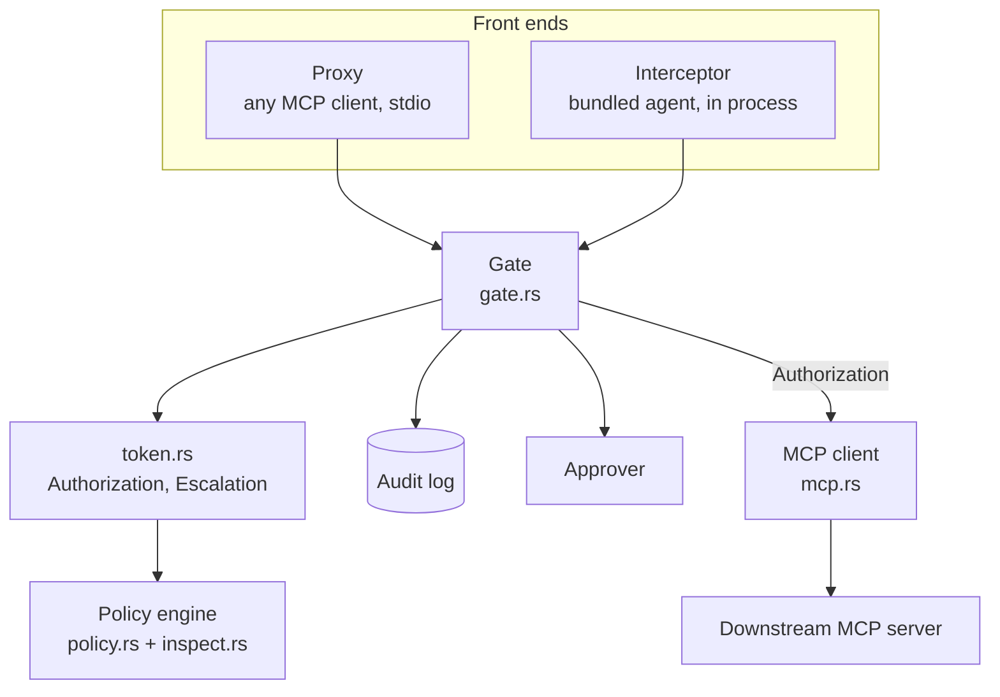

# Architecture

How `authz` is put together. For the guarantees this design provides, see
[security.md](security.md); for every command and file format, see [reference.md](reference.md).

## Components

| crate | role |
| --- | --- |
| `authz-core` | Shared types: `ToolCall`, `Decision`, `Context` (task, scope, history, taint ledger, hints), the `Policy` trait. No I/O. |
| `authz-guard` | The security core: `Gate`, capability tokens, policy engine, argument inspection, audit log, tool pinning, the MCP client, and the two front ends. |
| `authz-cli` | The `authz` binary: `proxy`, `init`, `audit`, `run`, `eval`, `serve-tools`. |
| `authz-agent` | The bundled agent loop and model backends (scripted, Ollama), used for the evaluation. It has no dependency on the tool client. |
| `authz-tools` | A simulated MCP server for the evaluation. Nothing is sent, fetched or executed; every call is logged to a sandbox file. |

## A tool call through the proxy

1. The client sends `tools/call` to `authz proxy` over stdin.
2. **Pinning** (with `--pin`): the tool's current definition is fingerprinted and compared with the
   lock file. A changed or unknown tool is refused through `Gate::refuse`, which records it in the
   audit log.
3. **Decision.** `Gate::check` takes a snapshot of the session `Context` and calls
   `token::authorize(policy, call, ctx)`:
   - **allow:** the decision is written to the audit log, then an `Authorization` is returned;
   - **block:** the decision is written and the agent gets `BLOCKED: … (audit #n)`;
   - **escalate:** the escalation is written, the `Approver` answers (in the proxy, `--approve
     deny|allow`), the answer is written, and only an approval produces an `Authorization`.
4. **Execution.** `Mcp::exec_raw` consumes the `Authorization` and forwards exactly that call to the
   downstream server. It is crate-private, so nothing outside `authz-guard` can call it.
5. **Observation.** The result text goes to `Gate::observe`, which appends the call to the session
   history and, if the policy labels the tool (for example `taint: private`), adds the output to the
   taint ledger. The model never writes to the ledger.
6. The result goes back to the client unchanged.

`tools/list` is forwarded with drifted tools removed, so a changed description never reaches the
agent. The proxy presents itself as `authz-guard(<server name>)`.

The bundled agent takes the same path through the `Interceptor`. Its unguarded baseline in the
evaluation is the same path with an allow-everything policy, not a separate code path.

## Policy engine

`Rules::load` parses YAML with `serde-saphyr` into typed structs, rejecting unknown fields and
duplicate keys, compiles every pattern, and checks references (see
[reference.md](reference.md#load-time-checks)). Then, for each call:

1. The tool's entry, or the policy `default` for an unlisted tool, gives the starting verdict.
2. Every rule whose selectors (`class`, `tool`) match and whose conditions all hold is collected.
3. The most severe outcome wins (`deny` over `escalate` over allow); the other matches are kept in
   `also` for the audit log.

**Argument inspection** (`inspect.rs`). Each string value is expanded into variants: raw,
percent-decoded once and twice, and base64-decoded with two tokenizations (with and without `/`),
capped at 64 variants. Arrays and objects are searched recursively. `hosts()` extracts every
reading of a URL's host, ignoring `user:pass@` and the port, so all of them must be permitted.

**Taint** (`carries_taint`). An argument carries a label if, after decoding, it shares a run of at
least `min` characters with output recorded under that label in this session. A URL's host counts,
unless the source itself names that host: following a link is not a leak.

## Capability tokens

`token.rs` holds the only constructors:

- `Authorization`: bound to one `ToolCall`, not `Clone`, consumed by execution.
- `Escalation`: created only by `authorize` when the policy escalates, consumed by `approve`.
- `Refusal::Blocked(Decision)`: a deny. It has no conversion to either type.

Fields are private to the module, so constructing either token elsewhere is a compile error. The
trybuild tests in `crates/authz-guard/tests/ui` pin the exact errors (E0451, E0624).

## Files

| file | written by | read by |
| --- | --- | --- |
| policy (`*.yaml`) | you, or `authz init` as a draft | `Rules::load` at startup |
| audit log (`authz-audit.jsonl`) | `Audit`, append-only, before each call runs | you, `authz audit` |
| pin file (`tools.lock`) | `--pin` on first run, `--repin` | the proxy at startup |

Formats are in [reference.md](reference.md).

## Concurrency and failure

The session `Context` sits behind a mutex in the `Gate`; each decision works on a snapshot, so a
decision never sees half an update. The guard fails closed: a policy that does not load stops
startup, an audit write that fails refuses the call, and a downstream error is returned as an error,
never as a success.
