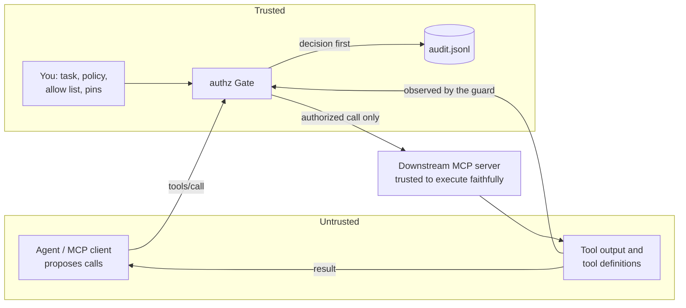

# Security model and assurance case

What you can and cannot expect from `authz`, and the argument for why the guarantees hold. For how
the parts fit together, see [architecture.md](architecture.md). To report a flaw, see
[SECURITY.md](../SECURITY.md).

## What you can expect

Each guarantee names how it is enforced and what checks it.

| # | Guarantee | Enforced by | Checked by |
| --- | --- | --- | --- |
| G1 | Every tool call is decided by the policy before it runs. There is no other path to execution. | Execution is crate-private and consumes an `Authorization` that only `token.rs` can create. | `tests/ui/bypass_exec.rs`, `forge_token.rs` (compile errors), `authz-agent/tests/boundary.rs` |
| G2 | A human can approve an escalation but can never override a deny. | A deny is a different type from an `Escalation` and has no path to an `Authorization`. | `tests/ui/forge_escalation.rs`, `m3_escalation.rs` |
| G3 | Every decision is on disk before the call runs. If it cannot be written, the call does not run. | `Gate::check` writes and syncs the audit record first, and refuses on a write error. | `m1_interceptor.rs`, `fail_closed.rs` |
| G4 | The agent never learns which rule refused it or why. | Refusals are a fixed `BLOCKED: … (audit #n)` text; the reason goes only to the audit log. | `m4_taint.rs` (`refusals_do_not_reveal_the_policy_to_the_agent`) |
| G5 | Policies only restrict. No rule can allow, and the most severe matching rule wins whatever the order. | The rule schema has no `allow` action; evaluation takes the maximum. | `policy.rs` (`deny_outranks_escalate_regardless_of_order`), `properties.rs` |
| G6 | Encoding does not hide an argument. Values are matched raw, percent-decoded (twice) and base64-decoded, inside arrays and objects. | `inspect.rs` | `properties.rs` (`encoded_secrets_never_leave`), fuzzing |
| G7 | Private data read earlier in the session cannot leave to a destination you did not permit, even with no secret pattern. | Taint ledger written by the guard from real tool output, never by the model. | `m4_taint.rs` |
| G8 | With pinning on, a tool whose definition changed is hidden from the agent and refused if called. | SHA-256 fingerprints in the lock file. | `proxy_pin.rs` |
| G9 | A malformed or ambiguous policy fails to load instead of loading weaker. | Duplicate keys, unknown fields, bad regexes, unknown references and unusable taint rules are load errors. | `policy.rs` unit tests (e.g. `duplicate_keys_are_rejected`), `fuzz/` (`policy`) |
| G10 | The published evaluation numbers are reproducible. | `authz eval`, scripted agent. | `m5_eval.rs` |

## What you cannot expect

These are limits of the design, not bugs. More detail in
[report/findings.md](../report/findings.md#limitations).

- **The policy is only as good as you write it.** A tool marked `allow` with no rules runs. `authz
  init` drafts a strict starting point, but you must review it.
- **Paraphrased data gets through.** Taint tracking catches data reused verbatim or in a supported
  encoding, not a summary of it, data split across calls, or an encoding the guard does not decode.
- **Pattern rules miss what they don't know.** A secret format or encoding not in the policy is not
  recognised as a secret.
- **Wrong content to a permitted destination is allowed** if it has no secret pattern and no overlap
  with private output.
- **The downstream server is trusted to do what the call says.** The guard decides what is sent to a
  server; it cannot stop a malicious server from acting on its own. Pinning detects definition
  changes, not a tool that was malicious when first pinned.
- **Only tool calls are mediated.** The proxy implements `tools/list` and `tools/call`; it does not
  forward resources, prompts or other requests to the downstream server.
- **Escalations fail closed in the proxy.** stdin carries the protocol, so the proxy cannot ask a
  person; `--approve allow` turns every escalation into an allow.
- **No protection against someone who can change your files.** Anyone who can edit the policy, the
  pin file, the audit log or the `authz` binary can defeat it.
- **The evaluation is small** (7 attacks, 6 benign tasks, one author) and has no adaptive attacker.

## Threat model

**Assets:** secrets and private data the agent can read; the systems its tools can change; the
integrity of the audit record.

**Adversary:** anyone who can put content in front of the agent: a fetched page, a file, an issue, a
tool result. Through prompt injection they may control every call the agent proposes. A second
adversary is an MCP server whose tool definitions change after you reviewed them (a "rug pull").

**In scope:** exfiltration through tool arguments, confused-deputy actions with the user's
privileges, destructive or out-of-scope actions, probing the policy through refusals, encoding and
URL-parsing tricks to slip past rules, and changed tool definitions.

**Out of scope:** tampering with the model, the host, or the files listed above; network attacks;
cost exhaustion; a downstream server that is malicious when first pinned.

## Trust boundaries

- **Agent → guard.** Every proposed call is untrusted input, whatever the model intended.
- **Server → guard.** Tool output, descriptions and annotations (`readOnlyHint` and so on) are
  untrusted. Output is used only to grow the taint ledger; annotations can only tighten a decision.
- **You → guard.** The policy, the allow list and the pin file are the only trusted inputs. In the
  bundled agent the user's task text is trusted too; in the proxy there is none, so the allow list
  takes its place.

## Secure design principles applied

- **Complete mediation.** One decision path (`Gate`) for both front ends, and the compiler rejects
  any other route to execution (G1).
- **Fail-safe defaults.** Unlisted tools get the policy's `default`; `authz init` drafts deny-all
  destinations; escalations are denied unless you choose otherwise; an audit write failure refuses
  the call; a doubtful policy fails to load.
- **Least privilege.** A session's scope lists the tools it may use, and destinations must be named
  in the task or the allow list; the shipped policies refuse everything else.
- **Separation of privilege.** A human's approval is a second, separate key that only works on
  escalations; it cannot unlock a deny (G2).
- **Economy of mechanism.** About 3,100 lines of Rust in five crates, with the security decision in
  one small module (`gate.rs`, `token.rs`, `policy.rs`, `inspect.rs`).
- **Open design.** The policy, the evaluation, the bypasses found and the limitations are all
  published. Security does not depend on the policy being secret, only on refusals not handing the
  attacker a free oracle (G4).
- **Psychological acceptability.** A refused call returns an ordinary tool error, so clients keep
  working; `authz audit` shows people what happened and why.

## Common weaknesses countered

| Weakness | Countermeasure |
| --- | --- |
| Memory corruption (CWE-787, CWE-416) | Safe Rust with no `unsafe` in this project's code; fuzzing under AddressSanitizer. |
| Missing or bypassable authorization (CWE-862) | Compile-time complete mediation (G1). |
| Validating before canonicalizing (CWE-180) | Arguments are decoded before matching (G6). |
| Interpretation conflicts in URLs (CWE-436) | `hosts()` strips `user:pass@` and the port and returns every reading a parser might take; all must be permitted. Found as a bypass and fixed with a regression test. |
| Path separator tricks (CWE-22) | Starter policies match both `/` and `\`; found as a bypass and fixed with a regression test. |
| Information exposure through error messages (CWE-209) | Generic refusals (G4). |
| Insufficient logging (CWE-778) | Write-ahead audit log, fail closed (G3). |
| Inefficient regular expressions (CWE-1333) | The `regex` crate runs in linear time; no backtracking. |
| Uncontrolled resource use in decoding (CWE-400) | Decoded variants per value are capped at 64. |
| Integer overflow (CWE-190) | Overflow checks stay on in release builds. |
| Unsafe parsing of configuration (CWE-502) | Typed deserialization, unknown fields and duplicate keys rejected (G9). |
| OS command injection (CWE-78) | The downstream server is started from an argument vector, never through a shell. |
| Vulnerable or tampered dependencies (CWE-1395, CWE-494) | `cargo deny` against RustSec on every push, Dependabot, actions pinned to commits, signed build provenance on releases. |

The six bypasses found so far, and the regression test for each, are listed in the
[README](../README.md#found-and-fixed) and [report/findings.md](../report/findings.md).

## Evidence

On every push and pull request, CI runs formatting, clippy with warnings as errors, the full test
suite (including the compile-fail tests), the evaluation, line coverage (fails below 80%), cargo-deny,
CodeQL and 60 seconds of fuzzing on each of three targets. See
[`.github/workflows`](../.github/workflows).
